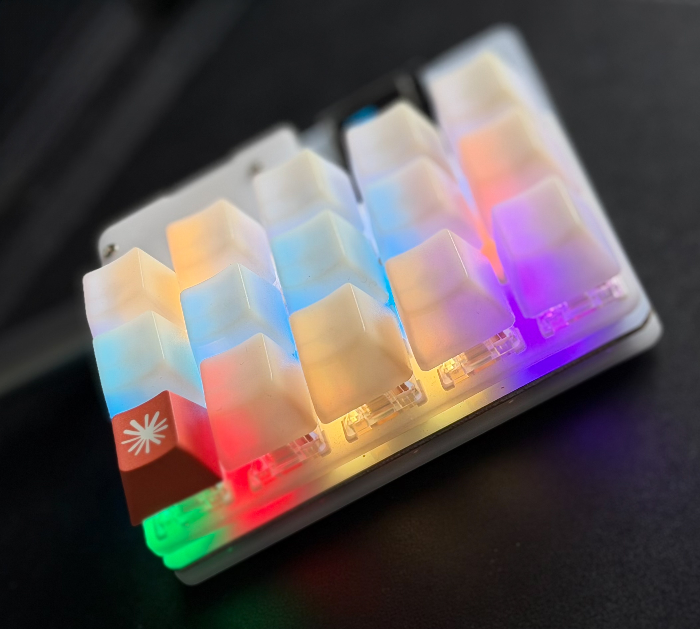

# 🦆 Raft

**A [duckyPad](https://github.com/dekuNukem/duckyPad) turned into a live status + control surface for a *raft* of [Claude Code](https://www.anthropic.com/claude-code) agents running in [cmux](https://github.com/manaflow-ai/cmux).**



> *A group of ducks resting on the water is called a **raft**. This is your control raft: one physical key per workspace, its LED showing what that agent is doing right now, and a press to jump straight to it — plus a row of Claude Code / cmux action macros.*

The top row is per-workspace keys whose **LEDs show live agent status** (amber = working, blue = needs you, green = done) and whose **presses jump to that workspace** (⌘1–5). The lower rows are Claude Code + cmux action macros (new workspace, next workspace, jump-to-unread, plan mode, interrupt, yes/no, `/clear`, `/compact`, rewind).

Inspired by **[OpenAI's Codex Micro](https://mashable.com/tech/openai-first-physical-release-is-micro-keyboard)** — OpenAI's first physical product, a Work Louder × OpenAI Supply macropad whose dedicated keys light up to show your coding agents' status. Raft reproduces the useful 80% — glanceable per-agent status + command keys — on an original (2020) duckyPad you may already own. (That's a Claude keycap on the *Yes* key in the photo.)

Raft is **built for Claude Code** — the status LEDs are driven by Claude Code lifecycle hooks and the action keys are Claude Code / cmux commands. But the firmware, LED protocol, and layout are **agent-agnostic**: point the hooks at another agent's events and swap the macro keys, and the same board works for Codex or anything else that can run a hook on start/stop/idle.

---

## The catch (and why this repo exists)

The obvious way to build this — have Claude Code hooks send the duckyPad's documented "Set RGB Single" HID command (`0x04`) to color each key — **does not work on stock firmware.** On the original duckyPad, that command is *defined in the firmware header and documented in the HID protocol, but never actually implemented*: the dispatcher has no branch for it, so it returns `UNKNOWN_CMD` (status 6) and nothing lights up. No stock OG-duckyPad firmware (v1.3.0 or the latest v3.0.4) can set a key's color from the host.

**Raft fixes that with a tiny custom firmware patch** that wires up the reserved command (plus keypress-persistence and a sleep-safe host-override layer), cross-compiled on macOS with a hand-rolled GNU toolchain setup. The minimal version of the patch is also being submitted upstream.

So the interesting half of this project is firmware; the rest is a small, no-daemon glue layer.

---

## How it works

Two independent channels, exactly like the Codex Micro's frosted status keys:

```
                 ┌─────────────────────────── inbound (status) ───────────────────────────┐
 Claude Code ── hook ──> duckypad_hook.py ── cmux identify ──> sudo duckypad_led.py <ws> <state>
 (SessionStart/                (resolves the firing session's            │
  Stop/Notification…)           own workspace → ordinal)                 └─ HID 0x04 → key LED

                 └────────────────────────── outbound (control) ─────────────────────────┘
 duckyPad key ── USB HID keystroke ──> cmux (⌘1–8 jump) / Claude Code (Esc, /clear, …)
```

- **Outbound** is just a normal USB-HID keyboard profile — no special software. `⌘1–5` jump cmux workspaces; other keys send Claude Code / cmux shortcuts.
- **Inbound**: a Claude Code hook fires on each lifecycle event, resolves *which workspace the firing session belongs to* via `cmux identify` (not the focused one — a background agent finishing still lights its own key), and sends one `0x04` packet to that key. Opening the HID interface needs root on macOS, so the LED writer runs behind a locked-down NOPASSWD-sudo helper. Each call opens/closes the device (no daemon, no persistent handle), and no-ops silently when the pad is unplugged.

---

## Key layout — the sample `cmux` profile

Held in **landscape with the USB cable at top-left** (this is the default profile in
[`profile/profile_cmux/`](profile/profile_cmux); edit [`profile/duckypad_build_profile.py`](profile/duckypad_build_profile.py) to change it):

```
┌────────┬────────┬────────┬────────┬────────┐
│  WS1   │  WS2   │  WS3   │  WS4   │  WS5   │  ← workspace status LEDs + jump (⌘1–5)
├────────┼────────┼────────┼────────┼────────┤
│ Unread │ New WS │ Next WS│ Rewind │ Intrpt │  ← navigation / actions
├────────┼────────┼────────┼────────┼────────┤
│  Yes   │   No   │ /clear │compact │ Auto/Pl│  ← Claude Code actions
└────────┴────────┴────────┴────────┴────────┘
```

| Key | Sends | Does | LED |
|---|---|---|---|
| **WS1–WS5** (top row) | `⌘1`–`⌘5` | Jump to cmux workspace 1–5 | **live agent status** — amber = working, blue = needs you, green = done |
| Unread | `⌘⇧U` | Jump to most-recent unread workspace | static |
| New WS | `⌘N` | New cmux workspace | static |
| Next WS | `⌃⌘]` | Next workspace | static |
| Rewind | `Esc` `Esc` | Open the rewind / checkpoint picker | static |
| Intrpt | `Esc` | Interrupt Claude | static |
| Yes | types `yes` ⏎ | Confirm a prompt | static |
| No | types `no` ⏎ | Decline a prompt | static |
| /clear | `/clear` ⏎ | Clear the conversation | static |
| /compact | `/compact` ⏎ | Compact the conversation | static |
| Auto/Pl | `⇧Tab` | Cycle Claude Code permission mode (normal → auto-accept → plan) | static |

The top row is the heart of it: each key both **shows** a workspace's agent status (its LED) and **jumps** to it (its keystroke). The lower rows only depend on which workspace you just focused — jump with the top row, then act.

> **Physical-key mapping:** in this landscape orientation the profile files map by physical key number — top row = `key3/6/9/12/15`, middle = `key2/5/8/11/14`, bottom = `key1/4/7/10/13` — and LED index = key-file number − 1. See [`docs/calibration.md`](docs/calibration.md).

---

## What you need

- An **original duckyPad (2020)** — STM32F072, 15 keys, per-key RGB. (Not the Pro; that's a different MCU/flow.)
- **macOS** (the sender/hooks assume it; the firmware is cross-platform).
- **cmux** with Claude Code sessions.
- Toolchain: `brew install --cask gcc-arm-embedded`, `brew install dfu-util`, and a Python 3.10+ with `pip install hidapi`.

---

## Reproduce it

Four stages — each directory has its own README with exact commands.

1. **Firmware** → [`firmware/README.md`](firmware/README.md)
   Clone `dekuNukem/duckyPad` (base commit `46dffb33`), copy in the GCC build files, apply [`firmware/raft-firmware.patch`](firmware/raft-firmware.patch), `make`, and DFU-flash. This gives you host-controllable per-key LEDs.

2. **Sender + hooks** → [`sender/README.md`](sender/README.md)
   `sudo bash sender/duckypad_install.sh` installs the root-owned LED writer + a tightly-scoped `/etc/sudoers.d/duckypad`. Then merge [`hooks/settings.snippet.json`](hooks/settings.snippet.json) into `~/.claude/settings.json`.

3. **Profile** → [`profile/README.md`](profile/README.md)
   Generate the 15-key profile from source (no GUI clicking) — duckyScript is compiled to `.dsb` byte-for-byte with the Configurator's own compiler — and push it over HID.

4. **Calibrate & test** → [`docs/calibration.md`](docs/calibration.md)
   Confirm the LED→key map for your orientation, then run parallel Claude sessions and watch the raft light up.

---

## Layout

```
firmware/   raft-firmware.patch + GNU build (Makefile.gcc, linker script, GCC startup)
sender/     duckypad_led.py (LED writer), duckypad_hook.py (cmux→LED bridge), duckypad_install.sh
profile/    build/compile/push scripts + the generated profile_cmux/
hooks/      settings.snippet.json (the Claude Code hook block to merge)
scripts/    probe / status / led-test / wake-test diagnostics
docs/       calibration, teardown
```

---

## Known limitations

- **OLED stays portrait.** The firmware has no 90° OLED rotation, so held in landscape the OLED text reads sideways. The keys and LEDs are laid out for landscape; the OLED is a secondary channel (blank keycaps + LED color are the real interface).
- **Uses flash beyond the datasheet spec.** The GCC/newlib image (~76 KB) exceeds the STM32F072C8's 64 KB spec. This die physically exposes 128 KB (the DFU descriptor reports it) and it's readback-verified on the test unit — but it's *technically out-of-spec*, so verify the readback on your own device. Fully recoverable: DFU is always available.
- **Interrupt leaves it amber.** Claude Code fires no hook when you interrupt a turn, so an interrupted session stays "working" until your next prompt (then self-corrects). Accepted, not worked around.
- **Sleep.** Set the pad's sleep to a long value or Never — waking reloads the profile; the firmware's host-override layer re-asserts status colors on same-profile wake, but Never avoids the whole question.

---

## Credits

- [duckyPad](https://github.com/dekuNukem/duckyPad) by dekuNukem — the hardware and firmware this builds on (MIT).
- [cmux](https://github.com/manaflow-ai/cmux) — the workspace manager and Claude Code hook bridge.
- Concept inspiration: [OpenAI's Codex Micro](https://mashable.com/tech/openai-first-physical-release-is-micro-keyboard) (Work Louder × OpenAI Supply) — OpenAI's first physical product.

## License

MIT — see [LICENSE](LICENSE). The firmware patch applies on top of dekuNukem/duckyPad (also MIT).
